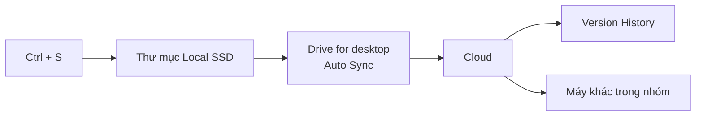

# Bài 1 : Hệ thống Quản lý Tài liệu Dự án Doanh nghiệp

## 1. Báo cáo Phân tích Hệ thống (Analysis Report)
### 1.1 Phân tích nguyên nhân

- Bạn A chỉ lưu file trên ổ cứng Local, thỉnh thoảng gửi Zalo.
- Ổ cứng hỏng thì không còn bản nào khác (single point of failure).
- Bản Zalo hết hạn tải nên không dùng được làm sao lưu.
### 1.2 Sơ đồ luồng dữ liệu:
 
 

- Mỗi lần lưu, file vào thư mục Local, được Drive for desktop tự tải lên Cloud.
- Cloud tự tạo phiên bản mới trong Version History.
- Các máy khác trong nhóm nhận bản mới qua đồng bộ.
### 1.3 Phương án dự phòng bằng Version History
Chuột phải file → Manage versions để xem các phiên bản.
- Bản ổn định: chọn Keep forever và đặt tên rõ (ví dụ `HienVat_v1_stable`).
- Bản hiện tại lỗi: tải bản ổn định về hoặc đặt nó làm bản hiện tại.

### 1.4 Bẫy: mất mạng hoặc sập nguồn giữa chừng
- Mất mạng: file đã lưu ở Local, Drive giữ hàng chờ và tự tải lên khi có mạng lại.
- Sập nguồn: khi bật máy, Drive đồng bộ lại các file dở dang. Chỉ phần chưa kịp Ctrl + S là có thể mất.
- Giảm rủi ro: Ctrl + S thường xuyên, bật Auto-save/Auto-recover trong phần mềm 3D, kiểm tra tick xanh trước khi tắt máy.
### 1.5 Xử lý xung đột phiên bản (File Version Conflict)
- Xảy ra khi 2 người cùng sửa 1 file lúc chưa đồng bộ.
- Hệ thống không ghi đè mà giữ cả hai bản (một bản thành file conflict).
- Người phụ trách so sánh, gộp thành 1 bản đúng, xóa bản thừa.
- Cả hai bản vẫn nằm trong Version History nên không mất dữ liệu.
## Phần 2: Quy trình thực thi (3 bước cho Designer)

1. Cài **Google Drive for desktop** và đăng nhập tài khoản.
2. Chọn thư mục dự án làm thư mục đồng bộ, dùng chế độ **Mirror files**.
3. Lưu file thiết kế vào thư mục này, kiểm tra biểu tượng **tick xanh** sau mỗi lần Ctrl + S.

   